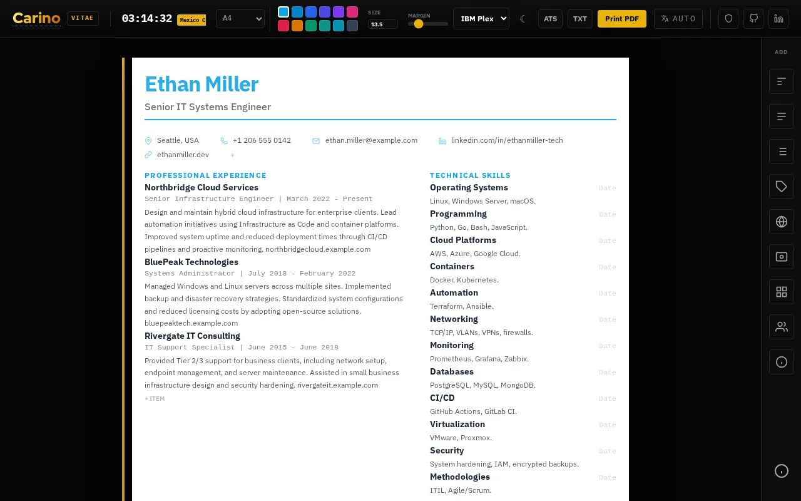

# Vitae

Build a résumé by editing it directly on the page (sections, columns, font and colour), then print it or save it as a PDF.

**[Open it →](https://vitae.carino.systems/)** — runs in your browser, nothing to install, no account.

## What it does

- Opens on a sample résumé that you type over. Add sections for a header, free text, lists (experience, education), skill tags, languages, contact details, a project grid, references and a disclaimer.
- Put each section full width, in the left column or in the right column, and move it up or down. Add more pages when one is not enough.
- Choose A4, Letter or Legal paper, one of 12 accent colours, one of four fonts, and set the text size and margins. A dark version of the résumé is one click away.
- Print PDF opens the browser's print dialog with the paper size already set. TXT downloads a plain-text copy.
- ATS stacks every section into one column, so applicant tracking systems read the PDF in order.
- Interface in English, Spanish, Portuguese (Brazil), Japanese and Russian.

The résumé is kept in the part of the page's link after `#` and updated as you type, so bookmark the link to come back to it. It is never sent to a server. Anyone you send the link to can read it.

## Licensing

**Mine — MIT licence.** Everything in this repository *except* the paths
listed below. Copyright © 2026 Miguel Carino. Full terms in [LICENSE](LICENSE).

**Not mine.** The files below are third-party works redistributed here. This
project's licence does not cover them and could not: they are not mine to
relicense. Each keeps its own terms, and each carries its own notice.

| Path | What it is | Licence | Notice |
| --- | --- | --- | --- |
| [`fonts/`](fonts/) | IBM Plex Mono, IBM Plex Sans, Inter, Red Hat Display, Roboto | SIL OFL 1.1 | [`fonts/OFL.txt`](fonts/OFL.txt) |
| [`vendor/`](vendor/) | third-party JavaScript | per package — see the notice | [`vendor/README.md`](vendor/README.md) |

Those files travel with any fork, mirror or repackaging of this repository, and
their notices must travel with them.
